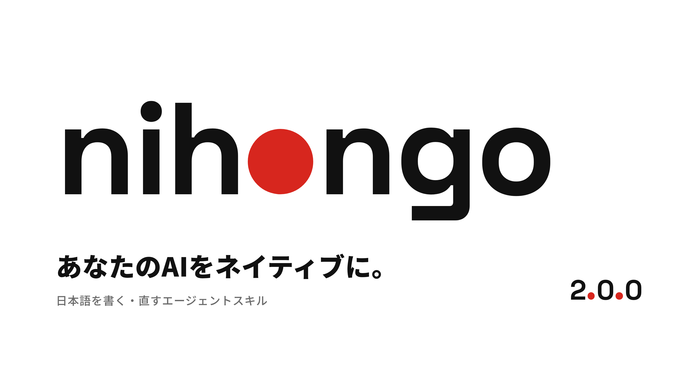

# nihongo

実はこのREADME、nihongoを入れたAIが全部書いています。人の手では1文字も直していないので、AIっぽいと感じた所があったらIssueで教えてください！

nihongoは、AIが書く日本語を、その場で人が書く文に近づけるためのエージェントスキルです。メール、お知らせ、Slack、README、ES、意見文などを新しく書く時にも、AIが書いた文を直す時にも使えます。

## 特徴

相手との距離に合わない敬語や中身のない前置き、1文ずつは正しいのに続けて読むと細切れになる文章など、AIの日本語の違和感は決まった言い回し以外の所からも出てきます。nihongoは禁止語を並べる代わりに、読み手・目的・載せる場所・書き手から、その場にいる人ならどう書くかを判断する手順をまとめています。

- お知らせ・お詫び・目上への文は硬い言葉と定型の敬語を残し、くだけた言い方に崩すのは友達とのやりとりだけにする
- 中身のない言葉（活用、実現、本質的）は普通の動詞に戻し、宣伝文の勢いや本人の気持ちの言葉は残す
- 文を分けるかつなげるかを、句点の数ではなく、情報のまとまりと流れで決める
- 自然な文は無理に直さず、数字・日付・条件・誰が何をするかは変えない

## 使用例

AIが書いたSlackの投稿です。

```
@channel お疲れさまです！

本日のデプロイについて共有させていただきます🚀

**結論**：本日18時のリリースは予定どおり実施します。

**背景**：昨日発見された決済画面の不具合は、すでに修正済みであり、ステージング環境での検証も完了しております。

**お願い**：18時〜18時30分の間は、本番環境への変更を控えていただけますと幸いです。

ご不明点等ございましたら、お気軽にスレッドにてお知らせください！引き続きよろしくお願いいたします🙏
```

nihongoで直すと、こうなりました。

```
@channel お疲れさまです！
本日18時のリリースは予定どおり実施します🚀

昨日見つかった決済画面の不具合は修正済みで、ステージング環境での検証も完了しています。

**18時〜18時30分は、本番環境への変更を控えてください。**

不明点があればスレッドでお知らせください。よろしくお願いします🙏
```

「結論：」「背景：」のようなラベルを外し、社内のチャットには重すぎる「させていただきます」「いただけますと幸いです」を、チームに向けた普通の言い方にしています。日時やお願いの中身は変えていません。

## LiteとFull

nihongoには、いつも効かせるLiteと、詳しい手順が全部入ったFullがあります。

| | Lite | Full |
|---|---|---|
| ファイル | `nihongo/ALWAYS.md`（約1,100字） | `nihongo/SKILL.md` と `references/` |
| 効く場面 | 普段の返事、雑談、短い質問まで毎回 | メール、お知らせ、ES、資料、README、UIの文言 |
| 読み込まれ方 | 設定に入れておけば、毎回読み込まれる | Liteから自動で読みにいく。名前を出して呼ぶこともできる |
| 増えるトークン（目安） | 約1,000 | 約9,000 |

Liteを入れておくと、普段はLiteだけが効いて、人に出す文章を書く時だけFullまで読みます。トークンを抑えながら、大事な文章では詳しい手順を使えます。

## インストール

### 1. スキルを入れる

Node.jsが入っていれば、次のコマンドで入れられます。

```
npx skills add AnIT012/nihongo -g
```

`npx skills add` は、GitHubのリポジトリからスキルを取ってきて、Claude CodeやCodexなどのスキルの置き場所に入れるコマンドです。`-g` を付けると、すべてのプロジェクトで使えるように、自分のユーザーの置き場所（Claude Codeなら `~/.claude/skills/`）に入ります。

ClaudeやChatGPTのアプリで使う場合は、`nihongo/` フォルダをzipにまとめて、スキルの画面からアップロードしてください。ChatGPTでは、Skills の Create から「Upload from your computer」を選びます。

スキルを入れただけだと、FullはAIが必要だと判断した時にしか読まれません。短い返事や雑談では、まず読まれません。毎回効かせるには、次の手順2でLiteを設定に入れてください。

### 2. Liteを設定に入れる

Claude Codeなら、`~/.claude/CLAUDE.md` に次の1行を足します。

```
@~/.claude/skills/nihongo/ALWAYS.md
```

`CLAUDE.md` は、Claude Codeが会話を始めるたびに必ず読み込む設定ファイルです。その中で `@` の後にファイルの場所を書くと、そのファイルの中身も一緒に読み込まれます。`-g` を付けずにプロジェクトに入れた場合は、プロジェクトの `CLAUDE.md` に `@.claude/skills/nihongo/ALWAYS.md` と書いてください。

ほかの環境では、次の場所に `ALWAYS.md` の中身をそのまま貼ってください。どれも会話のたびに必ず読み込まれる場所です。

- Codex：`~/.codex/AGENTS.md` か、プロジェクトの `AGENTS.md`
- ClaudeやChatGPTのアプリ：設定にある、AIへの指示や好みを書く欄

### Fullを呼び出す

Liteを入れていれば、メールや資料を書く時は自動でFullが使われます。それ以外でも本気で直したい時は、「nihongoで直して」のように名前を出して頼むか、Claude Codeなら `/nihongo` と送ってください。

Pythonが使える環境では、推敲の最後に `nihongo/scripts/` のスクリプトで意味の崩れを確かめます。Pythonが無くても、スキルはそのまま使えます。

## ファイル構成

| ファイル | 内容 |
|---|---|
| `nihongo/ALWAYS.md` | Lite。普段の返事に毎回当てる原則と、Fullを読みにいく場面 |
| `nihongo/SKILL.md` | Full。全体の原則、判断の優先順位、生成と推敲の進め方、句点と文章全体のリズム |
| `nihongo/references/` | 場面ごとの資料（会話、LINE・Slack、メール、お知らせ、UI文言、スライド、技術文書、ES、エッセイ、スピーチ、翻訳、敬語、表記、仕上げの点検など） |
| `nihongo/references/personal-profile.md` | 自分の文体を書き込むひな形 |
| `nihongo/scripts/` | 推敲の前後を比べて、数値・否定・確かさ・強さなどが変わった文だけを原文に戻すスクリプト（標準ライブラリだけで動く） |
| `evaluations/` | 検証の記録と、課題の原文 |
| `CHANGELOG.md` | 変更履歴 |

場面ごとの資料は、その場面の文章を書く時だけ読む作りなので、毎回すべてを読み込むわけではありません。

## 文体のカスタマイズ

自分の名前で出す文章（メール、ES、SNSの投稿など）を普段の書き方に寄せたい時は、`personal-profile.md` に好みの硬さや避けたい言い回しを書いてください。自分で直した文の前と後を表に足していくと、その直し方が一番の基準として使われます。空のままでも、ほかの部分は普通に動きます。

## 評価

社内のお知らせ、PRの説明、友達へのLINE、Slackの投稿、障害のお詫び、README、意見文の7つについて、AIが書いた原文をnihongoと推敲用に作られた別のスキルでそれぞれ直しました。どちらが直したかを伏せて作者が読み比べたところ、7つともnihongoの方が自然でした。

意味が崩れていないかは、条件や否定、誰が何をするかをわざと入れた業務文書で確認しました。別のAIに31項目を判定させたところ、事実や求める行動が変わった所はありませんでした。

技術文書では、README、API仕様、障害報告、コードレビューなどの課題を別のAIに目隠しで判定させ、スキルを使わない場合や、推敲用に作られた別のスキルとも比べています。

1.2.0では、推敲の最後にスクリプトで意味の崩れを見つけ、崩れた文だけを原文に戻す手順を足しました。1.3.0では、読みやすさの研究を参考に、長い文章の文と文のつながりの決まりを足しました。1.4.0では、技術文書で誇張や仕組みの説明を言い換えない決まりを足し、技術文書10題を2回ずつ比べて17勝1敗2分けになりました。お知らせ、メール、技術文書、意見文など33題を2回ずつ、推敲用に作られた別のスキルと目隠しで比べて46勝14敗6分けでした。

2.0.0では、雑談、LINE、短い質問、お礼のメール、自己PR、UIの文言、お知らせの15題で、Lite、Full、推敲用に作られた別のスキルの3つを目隠しで比べました。別のスキルに対して、Liteは13勝2敗、Fullは12勝3敗で、LiteとFullは8勝7敗のほぼ互角でした。依頼に無い理由・感想・約束などを足した作り話は、LiteとFullが3件ずつ、別のスキルが9件でした。スキルを使わない場合は、作り話が起きやすい11題で33件ありました。目隠しで比べた組は、これまでに約1,400組あります。

判定したのは作者1人か同じ会社のAIなので、数字は目安として見てください。ルールを足しては比べ、勝てなかった変更を捨ててきた記録と、課題の原文は [evaluations/](evaluations/) にあります。

## バージョンの付け方

バージョンは「1桁目.2桁目.3桁目」で、左から次の意味です。

- 1桁目：使い方が変わる大きな更新（2.0.0の、LiteとFullの2本立てなど）
- 2桁目：決まりの追加や改善
- 3桁目：細かい直し

## 注意事項

nihongoはプログラムを含まず、Markdownの文章だけでできています。AIが手順を読んで判断する作りなので、同じ依頼でも毎回まったく同じ文になるとは限りません。

内容の正しさまでは保証しないので、数字や日付、固有名詞は送る前に自分の目で確認してください。

## 制作について

Claude（Anthropic）と一緒に作りました。方針を決め、ルールの一部を書き、目隠しの判定で採用するかを決めたのは作者です。

## ライセンス

MIT Licenseで、詳しくは `LICENSE` に書いてあります。
