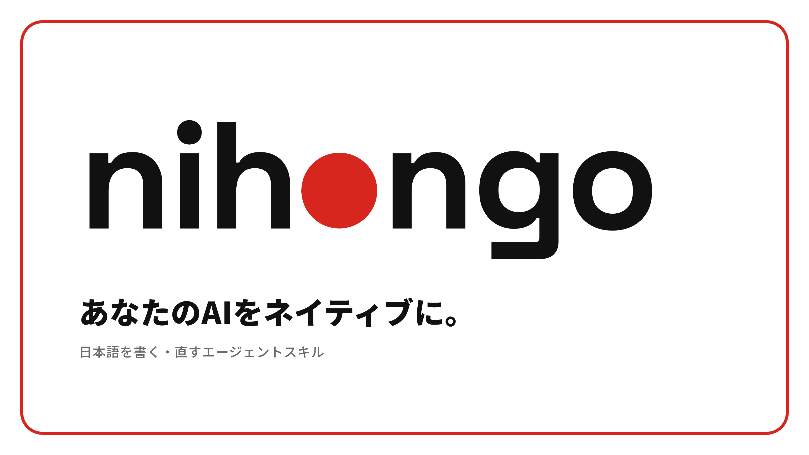

# nihongo

[](CHANGELOG.md)
[](https://github.com/AnIT012/nihongo/stargazers)
[](LICENSE)
[](#インストール)

実はこのREADME、nihongoを入れたAIが全部書いています。人の手では1文字も直していないので、AIっぽいと感じた所があったらIssueで教えてください！

nihongoは、AIが書く日本語を人が書く文に近づけるエージェントスキルです。書いた文を後から直すだけでなく、AIが書く時から自然な日本語にします。設定に入れておけば、雑談の返事からメール、README、ESまで、最初に出てくる文から自然になります。

## まず試す（Claude Code）

```
npx skills add AnIT012/nihongo -g -a claude-code
echo '@~/.claude/skills/nihongo/ALWAYS.md' >> ~/.claude/CLAUDE.md
```

1行目でスキルを入れ、2行目でLiteが毎回読み込まれるようにします。ほかの環境での入れ方は[インストール](#インストール)にあります。

## 特徴

禁止語を並べるのではなく、読み手・場面・書き手から、その場の人ならどう書くかを判断します。

- 最初から自然に書くので、あとで直す手間がいらない
- 要らない読点を打たずに書く（今日は、駅で → 今日は駅で）
- お知らせや目上への文は定型の敬語を残し、崩すのは友達とのやりとりだけにする
- 依頼に無い感想・理由・約束は書き足さず、数字・日付・条件・誰が何をするかは変えない
- 自然な文は無理に直さない

## 使用例

AIが書いたSlackの投稿です。

```
@channel お疲れさまです！

本日のデプロイについて共有させていただきます🚀

**結論**：本日18時のリリースは予定どおり実施します。

**背景**：昨日発見された決済画面の不具合は、すでに修正済みであり、ステージング環境での検証も完了しております。

**お願い**：18時〜18時30分の間は、本番環境への変更を控えていただけますと幸いです。

ご不明点等ございましたら、お気軽にスレッドにてお知らせください！引き続きよろしくお願いいたします🙏
```

nihongoで直すと、こうなりました。

```
@channel お疲れさまです！
本日18時のリリースは予定どおり実施します🚀

昨日見つかった決済画面の不具合は修正済みで、ステージング環境での検証も完了しています。

**18時〜18時30分は、本番環境への変更を控えてください。**

不明点があればスレッドでお知らせください。よろしくお願いします🙏
```

「結論：」「背景：」のようなラベルを外し、社内のチャットには重すぎる「させていただきます」「いただけますと幸いです」をチームに向けた普通の言い方にしています。日時やお願いの中身は変えていません。

## LiteとFull

nihongoには、毎回読み込む短いLiteと、詳しい手順が入ったFullがあります。両方入れておけば、普段はLiteだけを使い、人に出す文章を書く時だけFullまで読みます。

| | Lite | Full |
|---|---|---|
| ファイル | `nihongo/ALWAYS.md` | `nihongo/SKILL.md` と `references/` |
| 使う場面 | 普段の返事、雑談、短い質問 | メール、お知らせ、ES、資料、README、UIの文言 |
| 読み込まれ方 | 設定に入れておけば毎回 | 人に出す文章を書く時に自動で。名前を出して呼ぶこともできる |
| 増えるトークン（目安） | 約2,000 | 約10,000（使う時だけ） |

## インストール

スキルを入れて、Liteを毎回読み込まれる場所に置きます。使う環境を開いてください。

<details>
<summary><b>Claude Code</b></summary>

```
npx skills add AnIT012/nihongo -g -a claude-code
echo '@~/.claude/skills/nihongo/ALWAYS.md' >> ~/.claude/CLAUDE.md
```

`-a claude-code` を付けないと入れ先を聞かれるので、Claude Code をスペースキーで選んでください。プロジェクトだけに入れた場合は、プロジェクトの `CLAUDE.md` に `@.claude/skills/nihongo/ALWAYS.md` と書きます。

</details>

<details>
<summary><b>Codex</b></summary>

```
npx skills add AnIT012/nihongo -g
```

入れ先を聞かれたら Codex を選びます。Liteを入れるには、`ALWAYS.md` の中身を `~/.codex/AGENTS.md` かプロジェクトの `AGENTS.md` にそのまま貼ってください。

</details>

<details>
<summary><b>Muse</b></summary>

`nihongo/` フォルダをスキルの置き場に置くと、スキルとして読み込めたと報告をいただきました（Issue #15）。`npx skills add` で入れたスキルも、そのまま見えるはずです。Liteを入れるには、`ALWAYS.md` の中身を `AGENTS.md` に貼ってください。

</details>

<details>
<summary><b>ClaudeやChatGPTのアプリ</b></summary>

`nihongo/` フォルダをzipにまとめて、スキルの画面からアップロードしてください。ChatGPTでは、Skills の Create から「Upload from your computer」を選びます。Liteを入れるには、`ALWAYS.md` の中身を設定にあるAIへの指示や好みを書く欄にそのまま貼ってください。

</details>

### 使い方と更新

メールや資料を書く時はFullが自動で使われます。ほかの場面では「nihongoで直して」と頼むか、Claude Codeなら `/nihongo` と送ってください。更新は `npx skills update nihongo -g` です。

## 自分の書き方に合わせる

`nihongo/references/personal-profile.md` に一人称や口ぐせ、避けたい言い回しを書いておくと、LINEやメールなど自分の名前で出す文がその書き方になります。

## 評価

2.2.0を推敲用に作られた別のスキル（最新版）と同じ10題で比べた結果です。判定は別のAIが目隠しで行い、依頼どおりかを最優先に見ました。

| 見た点 | 結果 |
|---|---|
| 依頼どおりか（頼んだ中身がそろい、本人の経験や約束を作っていないか） | 2回の審査とも、LiteとFullの両方でnihongoが勝ち越し |
| 依頼に無い事実を作った案 | nihongoは0件。作ったのは別のスキルだけ |
| 自然さ | 2回の審査とも、別のスキルが勝ち越し |
| 10題を書いた時に増えたトークン | Fullは約1.9万、別のスキルは約4.1万 |

判定したのは作者か同じ会社のAIなので、数字は目安として見てください。版ごとの結果と課題の原文は [evaluations/](evaluations/) にあります。

## 変更履歴

各版の変更点は [CHANGELOG.md](CHANGELOG.md) にあります。

## 注意事項

AIが手順を読んで判断する作りなので、同じ依頼でも毎回同じ文になるとは限りません。数字や日付、固有名詞は送る前に自分の目で確認してください。

## 制作について

Claude（Anthropic）と一緒に作りました。方針を決め、ルールの一部を書き、目隠しの判定で採用するかを決めたのは作者です。

## ライセンス

MIT Licenseで、詳しくは `LICENSE` に書いてあります。
