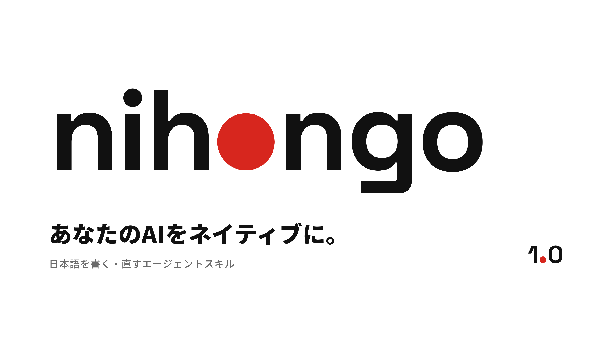

# nihongo

実はこのREADME、nihongoを入れたAIが全部書いています。人の手では1文字も直していないので、AIっぽいと感じた所があったらIssueで教えてください！

nihongoは、AIが書く日本語を、その場で人が書く文に近づけるためのエージェントスキルです。メール、お知らせ、Slack、README、ES、意見文などを新しく書く時にも、AIが書いた文を直す時にも使えます。

## 特徴

相手との距離に合わない敬語や中身のない前置き、1文ずつは正しいのに続けて読むと細切れになる文章など、AIの日本語の違和感は決まった言い回し以外の所からも出てきます。nihongoは禁止語を並べる代わりに、読み手・目的・載せる場所・書き手から、その場にいる人ならどう書くかを判断する手順をまとめています。

- お知らせ・お詫び・目上への文は硬い言葉と定型の敬語を残し、くだけた言い方に崩すのは友達とのやりとりだけにする
- 中身のない言葉（活用、実現、本質的）は普通の動詞に戻し、宣伝文の勢いや本人の気持ちの言葉は残す
- 文を分けるかつなげるかを、句点の数ではなく、情報のまとまりと流れで決める
- 自然な文は無理に直さず、数字・日付・条件・誰が何をするかは変えない

## 使用例

AIが書いたSlackの投稿です。

```
@channel お疲れさまです！

本日のデプロイについて共有させていただきます🚀

**結論**：本日18時のリリースは予定どおり実施します。

**背景**：昨日発見された決済画面の不具合は、すでに修正済みであり、ステージング環境での検証も完了しております。

**お願い**：18時〜18時30分の間は、本番環境への変更を控えていただけますと幸いです。

ご不明点等ございましたら、お気軽にスレッドにてお知らせください！引き続きよろしくお願いいたします🙏
```

nihongoで直すと、こうなりました。

```
@channel お疲れさまです！
本日18時のリリースは予定どおり実施します🚀

昨日見つかった決済画面の不具合は修正済みで、ステージング環境での検証も完了しています。

**18時〜18時30分は、本番環境への変更を控えてください。**

不明点があればスレッドでお知らせください。よろしくお願いします🙏
```

「結論：」「背景：」のようなラベルを外し、社内のチャットには重すぎる「させていただきます」「いただけますと幸いです」を、チームに向けた普通の言い方にしています。日時やお願いの中身は変えていません。

## インストール

Node.jsが入っていれば、次のコマンドで入れられます。

```
npx skills add AnIT012/nihongo
```

`npx skills add` は、GitHubのリポジトリからスキルを取ってきて、Claude CodeやCursorなどのスキルの置き場所に入れるコマンドです。`AnIT012/nihongo` はこのリポジトリを指しています。

手で入れる場合は、このリポジトリをダウンロードして、中の `nihongo/` フォルダをスキルの置き場所にコピーしてください。Claude Codeなら次のコマンドです。

```
cp -r nihongo ~/.claude/skills/
```

`cp -r` はフォルダを中身ごとコピーするコマンドで、`~/.claude/skills/` はClaude Codeが利用者の追加したスキルを読み込む場所です。

ClaudeやChatGPTのアプリで使う場合は、`nihongo/` フォルダをzipにまとめて、スキルの画面からアップロードしてください。ChatGPTでは、Skills の Create から「Upload from your computer」を選びます。

入れた後は、日本語の文章を書く・直す依頼をすれば `SKILL.md` の手順が使われます。

## ファイル構成

| ファイル | 内容 |
|---|---|
| `nihongo/SKILL.md` | いつも当てる原則、判断の優先順位、生成と推敲の進め方、句点と文章全体のリズム |
| `nihongo/references/` | 場面ごとの資料（会話、LINE・Slack、メール、お知らせ、UI文言、スライド、技術文書、ES、エッセイ、スピーチ、翻訳、敬語、表記、仕上げの点検など） |
| `nihongo/references/personal-profile.md` | 自分の文体を書き込むひな形 |

場面ごとの資料は、その場面の文章を書く時だけ読む作りなので、毎回すべてを読み込むわけではありません。

## 文体のカスタマイズ

自分の名前で出す文章（メール、ES、SNSの投稿など）を普段の書き方に寄せたい時は、`personal-profile.md` に好みの硬さや避けたい言い回しを書いてください。自分で直した文の前と後を表に足していくと、その直し方が一番の基準として使われます。空のままでも、ほかの部分は普通に動きます。

## 評価

社内のお知らせ、PRの説明、友達へのLINE、Slackの投稿、障害のお詫び、README、意見文の7つについて、AIが書いた原文をnihongoと推敲用に作られた別のスキルでそれぞれ直しました。どちらが直したかを伏せて作者が読み比べたところ、7つともnihongoの方が自然でした。

意味が崩れていないかは、条件や否定、誰が何をするかをわざと入れた業務文書で確認しました。別のAIに31項目を判定させたところ、事実や求める行動が変わった所はありませんでした。

判定したのは作者1人で、直したのも確認したのも同じAIなので、数字は目安として見てください。

## 注意事項

nihongoはプログラムを含まず、Markdownの文章だけでできています。AIが手順を読んで判断する作りなので、同じ依頼でも毎回まったく同じ文になるとは限りません。

内容の正しさまでは保証しないので、数字や日付、固有名詞は送る前に自分の目で確認してください。

## 制作について

Claude（Anthropic）と一緒に作りました。方針を決め、ルールの一部を書き、目隠しの判定で採用するかを決めたのは作者です。

## ライセンス

MIT Licenseで、詳しくは `LICENSE` に書いてあります。
